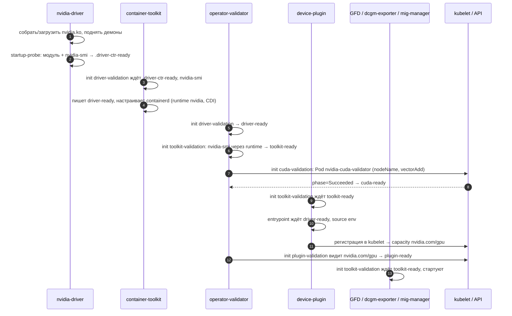

# Как работает validator в NVIDIA GPU Operator

Разбор по исходникам, а не по документации:

| Репозиторий | Коммит | Что смотрел |
|---|---|---|
| NVIDIA/gpu-operator | `304898f` (18.11.2026) | `cmd/nvidia-validator/main.go`, `metrics.go`; `assets/state-operator-validation/0500_daemonset.yaml`; `assets/state-driver/0400_configmap.yaml`; DaemonSet'ы `state-container-toolkit`, `state-device-plugin`, `gpu-feature-discovery`, `state-dcgm-exporter`, `state-mig-manager`; `validator/manifests/*.yaml`; `controllers/object_controls.go` (`TransformValidator*`) |
| NVIDIA/gpu-operator | `5a9c8a8` (12.10.2026) | `deployments/gpu-operator/values.yaml` |
| NVIDIA/gpu-driver-container | `3ac6796` (16.11.2026) | `rhel9/nvidia-driver` |

При смене версии чарта сверяйся заново: имена файлов и порядок проверок меняются.

---

## TL;DR

- Validator — это **DaemonSet `nvidia-operator-validator`** на GPU-нодах. Вся работа идёт в его **init-контейнерах**, по одному на компонент: `driver → toolkit → cuda → plugin`. Основной контейнер ничего не проверяет, он просто спит.
- Каждая проверка запускает один и тот же бинарь `nvidia-validator` с `COMPONENT=<имя>`. При успехе он пишет **маркер-файл** в hostPath `/run/nvidia/validations/` (`driver-ready`, `toolkit-ready`, `cuda-ready`, `plugin-ready`).
- **Другие операнды ждут эти маркеры** в своих init-контейнерах или entrypoint. Так и получается порядок старта на ноде. Оператор этот порядок не обеспечивает: он применяет все state'ы за один reconcile.
- `cuda` и `plugin` не ограничиваются проверками внутри своего пода: они **создают отдельные поды** с `vectorAdd` на этой же ноде, то есть проверяют GPU реальной CUDA-нагрузкой.
- `/run` — это tmpfs. После перезагрузки ноды маркеров нет, и цепочка проходит заново. При остановке пода validator'а маркеры удаляются в `preStop`.

---

## 1. Где живёт validator

```yaml
# assets/state-operator-validation/0500_daemonset.yaml (сокращено)
kind: DaemonSet
metadata: {name: nvidia-operator-validator}
spec:
  template:
    spec:
      nodeSelector:
        nvidia.com/gpu.deploy.operator-validator: "true"   # ставит оператор на GPU-нодах
      priorityClassName: system-node-critical
      serviceAccountName: nvidia-operator-validator
      initContainers: [driver-validation, toolkit-validation, cuda-validation, plugin-validation]
      containers:
      - args: ["echo all validations are successful; while true; do sleep 86400; done"]
        lifecycle:
          preStop:
            exec: {command: ["sh", "-c", "rm -f /run/nvidia/validations/*-ready"]}
      volumes:
      - {name: run-nvidia-validations, hostPath: {path: /run/nvidia/validations}}
      - {name: driver-install-dir,     hostPath: {path: /run/nvidia/driver}}
      - {name: host-root,              hostPath: {path: /}}
      - {name: host-dev-char,          hostPath: {path: /dev/char}}
```

- **State в ClusterPolicy:** `state-operator-validation` идёт после `state-container-toolkit` и до `state-device-plugin` (`controllers/state_manager.go`).
- **runtimeClassName** проставляет оператор (`setRuntimeClassName` в `TransformValidator`). Значение берётся из `operator.runtimeClass`, по умолчанию `nvidia`.
- **Образ** тот же, что у оператора: `validator.repository/image` = `nvcr.io/nvidia/gpu-operator`.
- Все init-контейнеры работают с `privileged: true`.

## 2. Бинарь `nvidia-validator`

Одна программа, режим выбирается переменной `COMPONENT`.

| Флаг / env | Default | Смысл |
|---|---|---|
| `COMPONENT` | — | `driver`, `toolkit`, `cuda`, `plugin`, `metrics`, а также `mofed`, `vfio-pci`, `vgpu-manager`, `vgpu-devices`, `cc-manager`, `nvidia-fs`, `gdrcopy`, `nvidia-peermem` |
| `WITH_WAIT` | `false` | `true`: крутиться в цикле, пока проверка не пройдёт. `false`: упасть сразу, повтором займётся kubelet через рестарт init-контейнера с backoff |
| `WITH_WORKLOAD` | `true` | запускать ли тестовый под (для `cuda` и `plugin`) |
| `SLEEP_INTERVAL_SECONDS` | `defaultSleepIntervalSeconds` | пауза между повторами при `WITH_WAIT` |
| `--output-dir` | `/run/nvidia/validations` | куда писать маркеры |
| `--cleanup-all` | — | перед проверкой удалить весь каталог маркеров |
| `DISABLE_DEV_CHAR_SYMLINK_CREATION` | — | не создавать симлинки в `/dev/char` (см. driver) |

Общий паттерн каждой проверки (`validate()`):

1. `deleteStatusFile(<marker>)`: удалить старый маркер, чтобы не висел ложный «ready».
2. Выполнить проверку.
3. При успехе `createStatusFile(<marker>)`. Для `driver-ready` запись атомарная: `utils.WriteFileAtomically`.

## 3. Маркер-файлы в `/run/nvidia/validations`

| Файл | Кто пишет | Кто ждёт |
|---|---|---|
| `.driver-ctr-ready` | **startup-probe пода драйвера** (`state-driver/0400_configmap.yaml`) | validator `driver` (если драйвер ставит оператор); скрипт драйвера при GPUDirect RDMA |
| `.driver-daemons-status` | скрипт драйвера (`_set_daemons_status`) | startup-probe драйвера |
| `driver-ready` | validator `driver` | entrypoint device-plugin; `driver-validation` в DS toolkit |
| `toolkit-ready` | validator `toolkit` | init `toolkit-validation` в device-plugin, GFD, dcgm-exporter, mig-manager |
| `cuda-ready` | validator `cuda` | — (статус и метрика) |
| `plugin-ready` | validator `plugin` | — (статус и метрика) |
| `nvidia-fs-ready`, `gdrcopy-ready`, `nvidia-peermem-ready`, `mofed-ready` | validator, соответствующие компоненты | операнды GDS / GDRCopy / RDMA |
| `vfio-pci-ready`, `vgpu-manager-ready`, `vgpu-devices-ready`, `cc-manager-ready`, `workload-type` | validator в sandbox/vGPU/CC-режимах | sandbox-операнды |

## 4. Проверки по шагам

### 4.1 `driver-validation` (`COMPONENT=driver`, `WITH_WAIT=true`)

```text
удалить driver-ready
├─ драйвер на хосте?  (validateHostDriver: nvidia-smi под /host)
│    да → IS_HOST_DRIVER=true, дальше
└─ нет → драйвер в контейнере
     ├─ isDriverManagedByOperator: есть DaemonSet app.kubernetes.io/component=nvidia-driver
     │  с controller ownerRef на ClusterPolicy или NVIDIADriver?
     │    да → ждать /run/nvidia/validations/.driver-ctr-ready
     ├─ nvidia-smi из /run/nvidia/driver с LD_PRELOAD=<путь к libnvidia-ml>   (в цикле, WITH_WAIT)
     └─ если драйвер ставит оператор: доп. модули (nvidia-fs, gdrcopy, nvidia-peermem) по флагам
          из .driver-ctr-ready
создать симлинки /dev/char → устройства NVIDIA   (обход gpu-operator#430: systemd cgroup)
записать driver-ready (атомарно):
  IS_HOST_DRIVER=…  NVIDIA_DRIVER_ROOT=…  DRIVER_ROOT_CTR_PATH=…  NVIDIA_DEV_ROOT=…  DEV_ROOT_CTR_PATH=…
```

- С `--driver-validation-skip-gpu-init` вместо полного `nvidia-smi` выполняется `nvidia-smi --version`. Это для случая, когда GPU отданы в `vfio-pci` и инициализировать их нельзя.
- `driver-ready` — не просто флаг, а **env-файл**. device-plugin делает `. /run/nvidia/validations/driver-ready` и так узнаёт, где лежит драйвер: на хосте или в `/run/nvidia/driver`.

Что делает startup-probe драйвера перед `.driver-ctr-ready`:
- проверяет, что модуль загружен (`/sys/module/nvidia/refcnt`);
- проверяет, что демоны в состоянии `Ready`;
- проверяет, что `nvidia-smi` проходит;
- только после этого через `mv` атомарно кладёт файл с флагами `GDRCOPY_ENABLED`, `GDS_ENABLED`, `GPU_DIRECT_RDMA_ENABLED`.

В `preStop` пода драйвера `.driver-ctr-ready` удаляется.

### 4.2 `toolkit-validation` (`COMPONENT=toolkit`, `WITH_WAIT=false`)

```yaml
env:
- {name: NVIDIA_VISIBLE_DEVICES, value: "all"}
```

Validator просто запускает `nvidia-smi` **внутри своего контейнера**. Бинаря и библиотек драйвера в образе нет. Их подкладывает nvidia-container-runtime (или CDI) по `NVIDIA_VISIBLE_DEVICES=all`. Если `nvidia-smi` отработал, значит toolkit настроил containerd правильно. После этого пишется `toolkit-ready`.

При `WITH_WAIT=false` неудача приводит к выходу с ошибкой и рестарту init-контейнера kubelet'ом. В `kubectl get pod` это выглядит как `Init:CrashLoopBackOff` или `Init:Error`.

### 4.3 `cuda-validation` (`COMPONENT=cuda`, `WITH_WAIT=false`)

Создаёт **отдельный Pod** из `/opt/validator/manifests/cuda-workload-validation.yaml`:

```yaml
metadata:
  generateName: nvidia-cuda-validator-
  labels: {app: nvidia-cuda-validator}
  annotations:
    nvidia.cdi.k8s.io/container.cuda-validation: "management.nvidia.com/gpu=all"
spec:
  restartPolicy: OnFailure
  initContainers:
  - name: cuda-validation
    args: ["vectorAdd"]                      # CUDA sample
    env: [{name: NVIDIA_VISIBLE_DEVICES, value: "all"}]
    securityContext: {privileged: true}
  containers:
  - name: nvidia-cuda-validator
    args: ["echo cuda workload validation is successful"]
```

Перед созданием validator дополняет спеку:

- `spec.nodeName = <эта нода>`: **планировщик в обход**, под гарантированно попадает на проверяемую ноду;
- `ownerReferences` копирует у DaemonSet'а validator'а, то есть владелец — ClusterPolicy, и GC уберёт под вместе с ней;
- tolerations копирует у DaemonSet'а, а `image`, `imagePullPolicy`, `imagePullSecrets`, `runtimeClassName` берёт из env, которые проставил оператор;
- удаляет предыдущий под с `app=nvidia-cuda-validator` на этой ноде.

Дальше ждёт `status.phase == Succeeded`: до 60 попыток с паузой 5 секунд, то есть **около 5 минут**. Затем пишет `cuda-ready`.

Важно: **`nvidia.com/gpu` этот под не запрашивает**. GPU он получает через `NVIDIA_VISIBLE_DEVICES=all` плюс CDI-аннотацию `management.nvidia.com/gpu=all`. Поэтому `vectorAdd` работает **до** готовности device-plugin. Проверяется связка «драйвер + runtime + CUDA», планировщик в ней не участвует.

### 4.4 `plugin-validation` (`COMPONENT=plugin`, в DaemonSet `WITH_WORKLOAD=false`)

1. Ждёт, что в `node.status.capacity` появится `nvidia.com/gpu` или `nvidia.com/mig-*` в количестве не меньше 1: 30 попыток по 5 секунд, около 150 секунд. Это доказывает, что device-plugin зарегистрировался в kubelet.
2. Если `WITH_WORKLOAD=true` (в манифесте DaemonSet стоит `false`), создаёт под из `plugin-workload-validation.yaml`. Он запрашивает **1 GPU через allocatable**: сначала MIG-ресурс, если есть, иначе `nvidia.com/gpu`. Внутри тот же `vectorAdd`, ожидание `Succeeded` до 5 минут. Так проверяется полный путь «scheduler → kubelet → Allocate плагина».
3. Пишет `plugin-ready`.

Если device-plugin выключен в ClusterPolicy, оператор **вырезает** init-контейнер `plugin-validation` из DaemonSet'а (`TransformValidatorComponent`).

## 5. Как операнды ждут validator

```sh
# toolkit-validation в device-plugin, GFD, dcgm-exporter, mig-manager
until [ -f /run/nvidia/validations/toolkit-ready ] && \
      { grep -qsx live /sys/module/nvidia/initstate || [ -e /dev/dxg ]; }; do
  echo waiting for nvidia container stack to be setup; sleep 5
done
```

```sh
# entrypoint device-plugin (ConfigMap nvidia-device-plugin-entrypoint)
until [ -f /run/nvidia/validations/driver-ready ]; do sleep 5; done
set -o allexport
. /run/nvidia/validations/driver-ready     # NVIDIA_DRIVER_ROOT и т.п. попадают в env плагина
```

В DS container-toolkit стоит init-контейнер `driver-validation`. Это **тот же бинарь** `nvidia-validator` с `COMPONENT=driver`, `WITH_WAIT=true`. Toolkit не начнёт настраивать containerd, пока драйвер не прошёл проверку.

Дополнительное условие `/sys/module/nvidia/initstate == live` — защита от устаревшего маркера: файл есть, а модуль выгружен (например, во время апгрейда драйвера). `/dev/dxg` нужен для WSL2.

## 6. Последовательность на свежей GPU-ноде



Маркер `driver-ready` может первым записать как DS toolkit, так и сам validator: оба запускают одинаковую проверку и пишут один и тот же файл.

## 7. Жизненный цикл маркеров

| Событие | Что происходит |
|---|---|
| Перезагрузка ноды | `/run` — tmpfs, все маркеры пропали, цепочка идёт заново |
| Удалён или перезапущен под validator'а | `preStop` удаляет `*-ready`; операнды, которые ещё не стартовали, будут ждать |
| Под драйвера остановлен (апгрейд) | его `preStop` удаляет `.driver-ctr-ready` и `.driver-daemons-status`; новые проверки `driver` будут ждать |
| Повторная проверка компонента | старый маркер удаляется **до** проверки, ложного «ready» во время перепроверки нет |
| Уже работающие операнды | маркеры читаются только при старте (init/entrypoint); удаление маркера работающий под **не останавливает** |

## 8. Метрики (`COMPONENT=metrics`)

Экспортёр нод в `cmd/nvidia-validator/metrics.go`. Service и ServiceMonitor лежат в `assets/state-operator-metrics`.

| Метрика | Смысл |
|---|---|
| `gpu_operator_node_driver_ready` | есть ли `driver-ready` |
| `gpu_operator_node_toolkit_ready` | есть ли `toolkit-ready` |
| `gpu_operator_node_cuda_ready` | есть ли `cuda-ready` |
| `gpu_operator_node_plugin_ready` | есть ли `plugin-ready` |
| `gpu_operator_node_driver_validation` | результат периодической проверки драйвера |
| `gpu_operator_node_driver_validation_last_success_ts_seconds` | время последней успешной проверки драйвера |
| `gpu_operator_node_device_plugin_devices_total` | сколько устройств объявил device-plugin |
| `gpu_operator_node_device_plugin_validation_last_success_ts_seconds` | время последней успешной проверки плагина |
| `gpu_operator_nvidia_pci_devices_total` | сколько NVIDIA PCI-устройств видно на ноде |
| `gpu_operator_node_metrics_ready_ts_seconds` | когда экспортёр стал готов |

Пример алерта: `gpu_operator_nvidia_pci_devices_total > 0 and gpu_operator_node_plugin_ready == 0` дольше 15 минут — на ноде есть GPU, но плагин не прошёл проверку.

## 9. Диагностика

```sh
NS=gpu-operator; NODE=<node>

# где застряла цепочка: имя init-контейнера в статусе
kubectl -n $NS get pod -l app=nvidia-operator-validator -o wide --field-selector spec.nodeName=$NODE
kubectl -n $NS logs <validator-pod> -c driver-validation      # затем toolkit-validation, cuda-validation, plugin-validation

# тестовые поды
kubectl -n $NS get pod -l app=nvidia-cuda-validator -o wide
kubectl -n $NS logs <nvidia-cuda-validator-xxxx> -c cuda-validation

# маркеры на ноде
kubectl debug node/$NODE -it --image=busybox -- ls -la /host/run/nvidia/validations/
kubectl debug node/$NODE -it --image=busybox -- cat /host/run/nvidia/validations/driver-ready

# перепройти цепочку
kubectl -n $NS delete pod <validator-pod>                      # preStop удалит *-ready
```

| Симптом | Где смотреть | Типичная причина |
|---|---|---|
| validator в `Init:0/4`, `driver-validation` долго крутится | логи пода драйвера, его startup-probe | драйвер не собрался (нет kernel-headers), Secure Boot отверг модуль, SELinux |
| `Init:CrashLoopBackOff` на `toolkit-validation` | логи DS toolkit, `/etc/containerd/config.toml` | runtime `nvidia` не прописан, containerd не перезапущен, у k3s свой путь к конфигу |
| `cuda-validation` падает, под `nvidia-cuda-validator` в `Error` | `kubectl logs ... -c cuda-validation` | несовпадение CUDA и драйвера, GPU в `Xid`/ECC-ошибках, MIG без инстансов |
| `plugin-validation` ждёт и падает через ~150 с | логи device-plugin, `kubectl describe node` (Capacity) | плагин не зарегистрировался, неверная `MIG_STRATEGY`, GPU не видны |
| device-plugin или GFD висят в `Init` | маркеры в `/run/nvidia/validations` | validator ещё не дошёл или был перезапущен и удалил маркеры |

## 10. Что из этого стоит перенять для своего оператора

- **Порядок на ноде задаётся файлами на хосте, а не reconcile'ом.** Оператор применяет всё сразу, а зависимости разрешаются локально, через init-контейнеры. Это не требует API-вызовов и переживает потерю связи с control plane.
- **Маркер удаляется до проверки и пишется атомарно.** Не бывает «ready» от прошлого прогона и не бывает недописанного файла.
- **Маркер можно сделать env-файлом.** Потребитель через `source` получает не только «готово», но и параметры (`NVIDIA_DRIVER_ROOT`).
- **Проверять реальной нагрузкой.** `vectorAdd` в поде с `nodeName` ловит то, что не видно по статусам: runtime, CUDA, состояние GPU.
- **tmpfs как граница жизни.** Состояние в `/run` пропадает при перезагрузке вместе с загруженными модулями, отдельная инвалидация не нужна.
- **Оборотная сторона:** маркеры читаются только при старте. Если драйвер деградировал на работающей ноде, это поймают не маркеры, а метрики `*_last_success_ts_seconds` или алерт.
